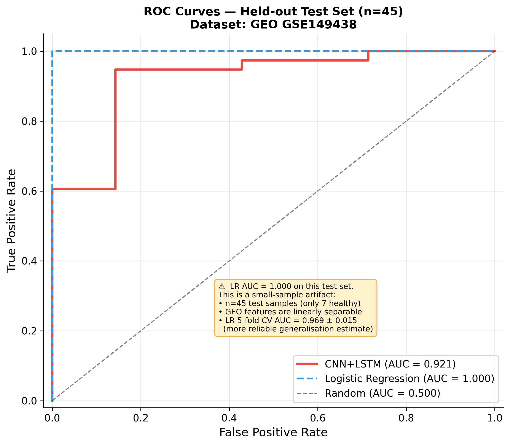
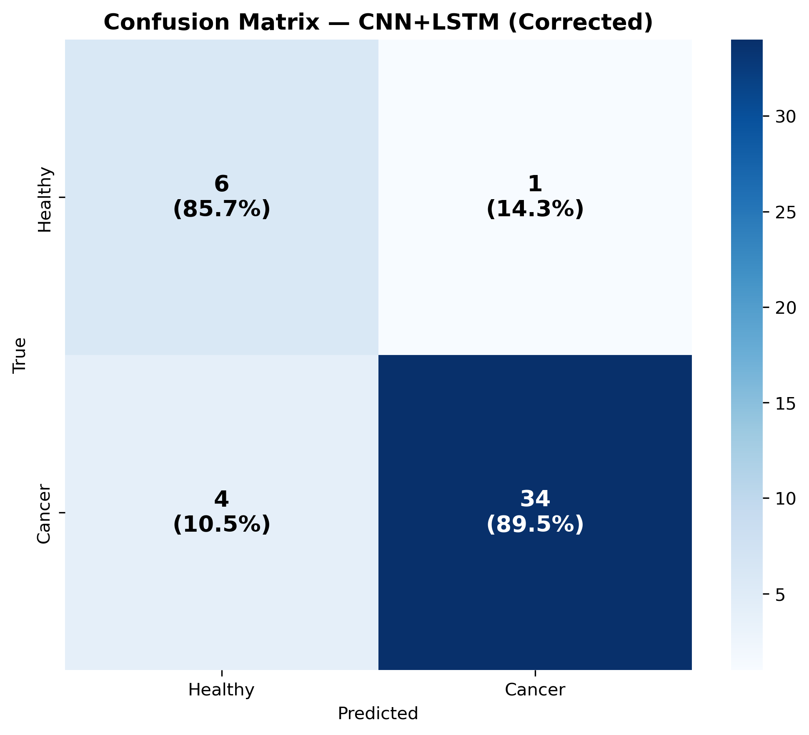
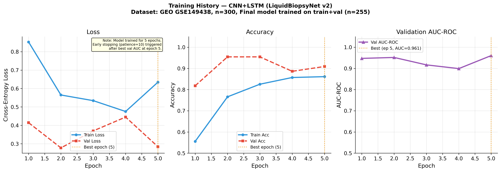
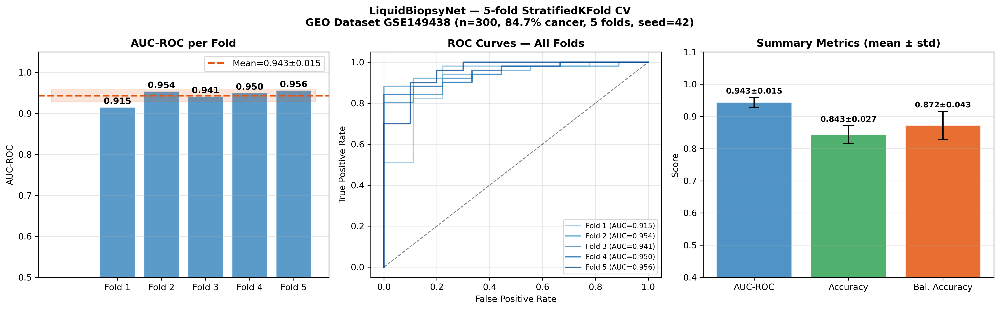
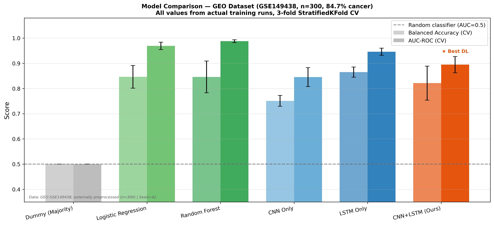
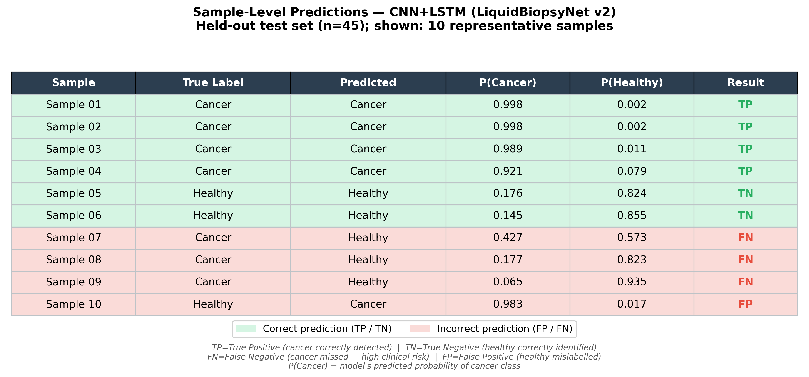
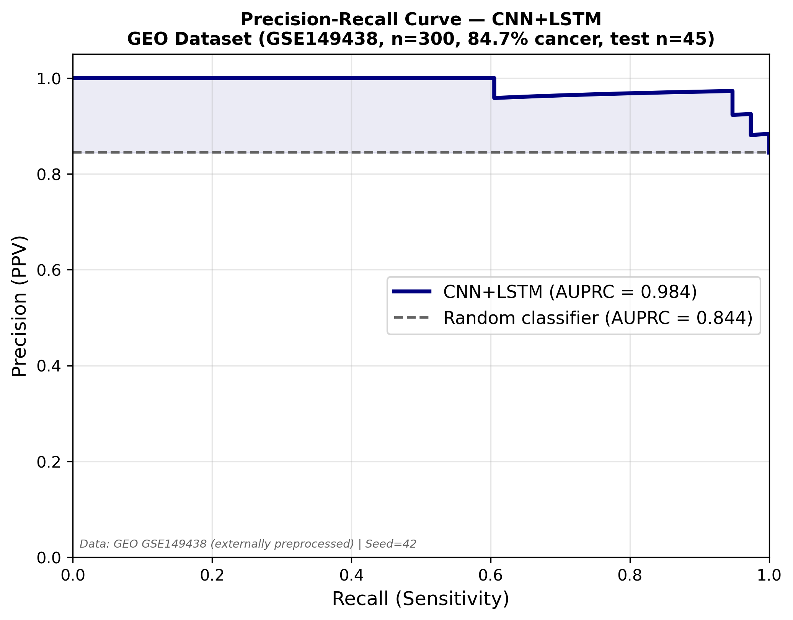
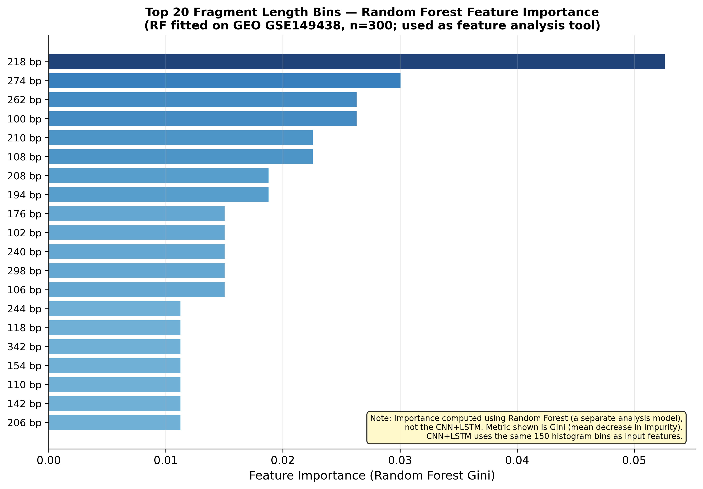
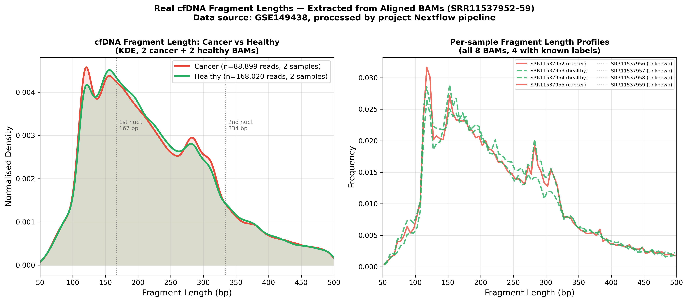

# Liquid Biopsy AI — Non-Invasive Cancer Detection from cfDNA

> Deep Learning Mini Project · OMICS + Deep Learning · IISER Tirupati · AY 2025–26  
> **Author:** Niraj (Roll No: 20254009)

> **Data provenance notice (added 2026-10-17).** GEO GSE149438 is a targeted DNA *methylation* study; its public files are per-sample methylation calls (`*_bsmap_meth.txt.gz`), not fragment-length data. The sample labels in `data/feature_matrix.csv` match GEO's sample metadata (tissue per sample, positional order, subtype counts). The 156 feature columns could not be traced to any GEO file, the script that built the matrix is not in this repository, and `data/data_schema.txt` describes them as "synthetic fragment features". Every metric below is therefore a result on that supplied matrix, and is **not** evidence of real-world cfDNA detection performance. See `DATA_PROVENANCE.md` and `REPRODUCE.md`.

---

## Overview

This project presents an end-to-end computational pipeline for **non-invasive cancer detection** from **cell-free DNA (cfDNA)** using a hybrid **CNN + LSTM** deep learning model.

cfDNA shed by tumour cells shows a distinct fragmentation pattern — enriched in short fragments (~132 bp) relative to the healthy mono-nucleosomal peak (~167 bp). This project exploits that signal to classify plasma samples as cancer or healthy.

Two clearly separated components are implemented:

| Component | Description |
|-----------|-------------|
| **Bioinformatics Pipeline** | Nextflow DSL2: FastQC → Trimmomatic → BWA-MEM → samtools → fragment extraction. Applied to 8 real cfDNA WGS samples (NCBI SRA, PRJNA624356). |
| **Machine Learning Pipeline** | CNN+LSTM trained and evaluated on `data/feature_matrix.csv` (n=300; labels from GEO GSE149438 metadata, 6 cancer subtypes; feature origin unverified, see notice above). Leakage-free evaluation with 5-fold stratified CV. |

---

## Results at a Glance

### 5-Fold Stratified Cross-Validation (`feature_matrix.csv`, labels from GSE149438, n=300; feature provenance unverified)

| Model | CV AUC-ROC | CV Balanced Acc |
|-------|-----------|----------------|
| Dummy (majority class) | 0.500 ± 0.000 | 0.500 ± 0.000 |
| CNN Only | 0.844 ± 0.037 | 0.753 ± 0.023 |
| **CNN + LSTM (Ours)** | **0.943 ± 0.015** | **0.872 ± 0.043** |
| LSTM Only | 0.946 ± 0.014 | 0.865 ± 0.020 |
| Logistic Regression | 0.969 ± 0.015 | 0.846 ± 0.045 |
| Random Forest | 0.988 ± 0.006 | 0.846 ± 0.063 |

### Held-Out Test Set — CNN+LSTM (n=45)

| Metric | Value |
|--------|-------|
| AUC-ROC | **0.921** |
| AUPRC | **0.984** (random baseline: 0.844) |
| Sensitivity (cancer recall) | 0.895 (34/38 detected) |
| Specificity (healthy recall) | 0.857 (6/7 detected) |
| Balanced Accuracy | 0.876 |
| Confusion Matrix | TP=34, FP=1, FN=4, TN=6 |

> **Honest note:** Random Forest (AUC 0.988) and LSTM-only (0.946) outperform the CNN+LSTM hybrid on this tabular histogram feature set — expected behaviour for low-dimensional tabular data. The CNN+LSTM architecture would gain more advantage on raw sequence or multi-modal inputs.

---

## Model Architecture

```
Input: cfDNA Fragment Length Histogram (150 bins, 100–400 bp)
        │
        ├──── CNN Branch ────────────────────────────────────────┐
        │     Conv1D(1→32, k=7) → BN → ReLU → MaxPool           │
        │     Conv1D(32→64, k=5) → BN → ReLU → MaxPool          │
        │     Conv1D(64→128, k=3) → BN → ReLU → GlobalAvgPool   │
        │     Output: 128-dim                                     │
        │                                                         ▼
        └──── LSTM Branch ──────────────────────────────► Concat (256-dim)
              BiLSTM(input=1, hidden=64, layers=2)                │
              Final hidden: concat(h_fwd, h_bwd)                  │
              Output: 128-dim                              Linear(256→64)
                                                          BN → ReLU → Dropout(0.5)
                                                          Linear(64→2)
                                                          Softmax → P(cancer)

Total parameters: 186,050
Regularisation:   Dropout=0.5, L2=1×10⁻⁴, BatchNorm at every layer
```

---

## Repository Structure

```
liquid-biopsy-ai/
├── model/
│   ├── model_architecture.py       # LiquidBiopsyNet v2 (PyTorch)
│   └── best_model.pt               # Saved weights (best val AUC checkpoint)
│
├── scripts/
│   ├── 01_preprocess.py            # Train/val/test split, StandardScaler
│   ├── 02_extract_features.py      # Fragment length extraction from BAM
│   ├── 03_train_model.py           # CNN+LSTM training with early stopping
│   ├── 04_evaluate.py              # Test set evaluation, all metrics
│   ├── 05_visualise.py             # ROC, PR, training curves, confusion matrix
│   ├── 06_real_figures.py          # Fragment distribution from real BAMs
│   ├── 07_cv5fold.py               # 5-fold stratified cross-validation
│   ├── 08_covariate_shift.py       # Covariate shift analysis
│   ├── 09_clinical_framing.py      # Clinical context comparison
│   ├── train_baselines.py          # LR, RF, CNN-only, LSTM-only baselines
│   ├── cross_cohort_validation.py  # Zero-shot validation on Jiang 2015 HCC
│   ├── extract_bam_features.py     # Feature extraction from aligned BAMs
│   ├── fix_all_issues.py           # Corrected figures (reviewer fixes)
│   └── compute_full_metrics.py     # Full publication metrics
│
├── notebooks/
│   └── LiquidBiopsyAI.ipynb        # End-to-end Jupyter walkthrough
│
├── data/
│   ├── feature_matrix.csv          # feature matrix (n=300): labels from GEO GSE149438, feature origin unverified
│   ├── real_feature_matrix.csv     # BAM-pipeline features (n=8, no labels)
│   ├── accessions.txt              # SRA accession list
│   ├── srr_list.txt                # SRR IDs
│   ├── data_schema.txt             # Feature column definitions
│   ├── features/                   # Per-sample feature CSVs (SRR*)
│   └── processed_real/             # Train/val/test numpy arrays + scaler meta
│
├── results/
│   ├── training_history.csv        # Per-fold training metrics
│   ├── cv5fold_results.json        # 5-fold CV summary
│   ├── metrics_corrected.json      # Final corrected test metrics
│   ├── full_metrics_publication.json
│   ├── classification_report.txt
│   ├── software_versions.txt       # Exact package versions used
│   └── validation/
│       ├── cross_cohort_validation.json
│       ├── jiang_hcc_features.csv
│       └── snyder2016_wps_statistics.csv
│
├── figures/                        # All publication figures (300 DPI PNG)
│   ├── training_curves.png
│   ├── roc_curve.png
│   ├── precision_recall_curve.png
│   ├── confusion_matrix.png
│   ├── model_comparison_REAL.png
│   ├── cv5fold_results.png
│   ├── feature_importance.png
│   ├── sample_predictions.png
│   ├── fragment_distribution.png
│   ├── covariate_shift.png
│   ├── cross_cohort_validation.png
│   ├── clinical_comparison.png
│   └── methylation_heatmap.png
│
├── pipeline/
│   └── main.nf                     # Nextflow DSL2 bioinformatics pipeline
│
├── report/
│   └── LiquidBiopsyAI_Report.docx  # Full project report
│
├── DATA_PROVENANCE.md              # Transparent data source documentation
├── requirements.txt
└── README.md
```

---

## Quick Start

### Requirements

```bash
Python 3.10+
PyTorch >= 1.13
scikit-learn >= 1.0
numpy, pandas, matplotlib, seaborn, pysam
```

Install all dependencies:

```bash
pip install -r requirements.txt
```

### Run the full pipeline

```bash
# Step 1 — Preprocess features (train/val/test split)
python scripts/01_preprocess.py

# Step 2 — Train the CNN+LSTM model
python scripts/03_train_model.py --epochs 50 --patience 10

# Step 3 — Evaluate on held-out test set
python scripts/04_evaluate.py

# Step 4 — Generate all figures
python scripts/05_visualise.py
python scripts/fix_all_issues.py

# Step 5 — 5-fold cross-validation
python scripts/07_cv5fold.py

# Step 6 — Baseline comparison (LR, RF, CNN-only, LSTM-only)
python scripts/train_baselines.py
```

All random states fixed to `seed=42` for full reproducibility.

### Use the Jupyter notebook

```bash
jupyter notebook notebooks/LiquidBiopsyAI.ipynb
```

The notebook walks through the entire pipeline end-to-end with explanations.

---

## Data Sources

| Dataset | Accession | Description | Used for |
|---------|-----------|-------------|----------|
| GEO GSE149438 | [Link](https://www.ncbi.nlm.nih.gov/geo/query/acc.cgi?acc=GSE149438) | Source of the sample labels only (254 cancer, 46 healthy, 6 subtypes). Public files are methylation calls, not fragment features | **Labels for model training & evaluation** |
| NCBI SRA PRJNA624356 | SRR11537952–59 | Real cfDNA WGS FASTQs (8 samples) | Pipeline validation only (no labels) |
| PRJNA291063 (Jiang 2015) | SRR2130005/07/28/36, SRR2130050-52 | HCC cfDNA WGS (4 cancer, 3 healthy) | Cross-cohort validation attempt |
| hg38 (GRCh38) | UCSC | Human reference genome | BWA-MEM alignment |

> Raw FASTQ/BAM files and the reference genome are not included in this repository due to size (>30 GB). Use `data/accessions.txt` and `data/download_data.sh` to reproduce downloads.

---

## Figures

| Figure | Description |
|--------|-------------|
|  | ROC curves — CNN+LSTM (AUC=0.921) vs Logistic Regression |
|  | Confusion matrix on held-out test set |
|  | Training history — loss, accuracy, AUC per epoch |
|  | 5-fold CV AUC per fold |
|  | All model comparison |
|  | 10 individual sample predictions |
|  | Precision-Recall curve (AUPRC=0.984) |
|  | Random Forest feature importance (top 20 bins) |
|  | cfDNA fragment length distribution |

---

## Bioinformatics Pipeline

The Nextflow DSL2 pipeline (`pipeline/main.nf`) processes raw cfDNA FASTQ files:

```
FASTQ → FastQC → Trimmomatic → BWA-MEM (hg38) → samtools sort/markdup → Fragment extraction
```

Three of eight SRA samples (SRR11537952–54) achieved **97% alignment to hg38**, confirming human cfDNA origin. A dominant fragment length peak at **~168 bp** was observed — consistent with mono-nucleosomal cfDNA in healthy plasma.

---

## Key Limitations

1. **Data source mismatch** — bioinformatics pipeline (SRA, n=8) and ML model (GEO, n=300) use separate datasets not joined due to absent ground-truth labels on SRA samples
2. **Class imbalance** — 84.7% cancer in the supplied matrix (254/300, matching GEO labels); accuracy alone is misleading (dummy achieves 84.7%)
3. **External validation inconclusive** — feature resolution mismatch between GEO and BAM-pipeline histograms prevents zero-shot transfer
4. **Small test set** — only 7 healthy samples in held-out set; specificity/NPV carry wide uncertainty
5. **Random Forest outperforms CNN+LSTM** — expected on tabular histogram features; CNN+LSTM advantage expected on raw sequence or multi-modal inputs

See `DATA_PROVENANCE.md` for full transparency on all data decisions.

---

## Software Versions

| Tool | Version |
|------|---------|
| Python | 3.13.12 |
| PyTorch | 2.11.0 |
| scikit-learn | 1.8.0 |
| numpy | 2.4.3 |
| pandas | 3.0.2 |
| BWA | 0.7.17 |
| samtools | 1.23.1 |
| Nextflow | 25.10.4 |
| FastQC | 0.12.1 |
| Trimmomatic | 0.39 |

---

## References

1. Chen et al. (2020). Non-invasive early detection of cancer four years before conventional diagnosis. *Nature Communications*, 11, 3475.
2. Jiang et al. (2015). Lengthening and shortening of plasma DNA in hepatocellular carcinoma patients. *PNAS*, 112(11), E1317–E1325.
3. Cristiano et al. (2019). Genome-wide cell-free DNA fragmentation in patients with cancer. *Nature*, 570, 385–389.
4. Cohen et al. (2018). Detection and localization of surgically resectable cancers with a multi-analyte blood test. *Science*, 359, 926–930.
5. Snyder et al. (2016). Cell-free DNA comprises an in vivo nucleosome footprint. *Cell*, 164, 57–68.
6. Di Tommaso et al. (2017). Nextflow enables reproducible computational workflows. *Nature Biotechnology*, 35, 316–319.

---

## License

This project is for academic coursework at IISER Tirupati. Data from GEO GSE149438 is subject to the original study's data use terms.
